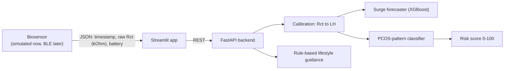

# LH Cycle Intelligence

An end-to-end machine-learning prototype for **point-of-care luteinizing hormone (LH) monitoring**: it forecasts the LH surge, flags PCOS-type cycle patterns, gives a preventive risk score and shows evidence-labelled lifestyle tips.


> **Research prototype on simulated data. Not a medical device and not a diagnosis.**
> No physical biosensor is connected yet; a simulator stands in for the hardware.

## Why this project

A published electrochemical biosensor (see [Reference](#reference)) can measure LH quickly at the point of care, but a raw sensor reading is not useful to a person on its own. This project builds the **software layer** that would sit behind such a device: calibration, forecasting, pattern detection, an API and an app, so that the hardware can be plugged in later using a defined JSON format.

## Demo

| Surge forecast | PCOS pattern & risk | Lifestyle tips |
|---|---|---|
|  |  |  |

## What it does

1. **Synthetic data generator.** Simulates daily LH over several menstrual cycles for many virtual users (normal, anovulatory, PCOS-type flat, erratic and delayed cycles), maps LH to charge-transfer resistance using the published calibration table, and adds device offsets and measurement noise.
2. **Surge forecaster.** XGBoost model that estimates the chance of an LH surge in the next 24 hours from recent readings and cycle history.
3. **PCOS-pattern classifier.** Per-cycle features (baseline, peak-to-baseline ratio, variability, spikes, cycle length) feed a Random Forest / XGBoost model. A user-level score averages up to 3 cycles.
4. **Risk score (0–100).** A transparent combination of PCOS-pattern probability, cycle irregularity and missing surges.
5. **Lifestyle guidance.** Rule-based tips tied to cycle phase, goal and pattern flags, each with an evidence label and source. No calorie targets, supplement doses or named diets.
6. **FastAPI backend and Streamlit app** with a simulated-biosensor button.

## Architecture



## Results (simulated data)

Default settings (`seed 42`, `--overlap 0.7`), evaluated on **held-out simulated users** (no user appears in both train and test):

| Task | Model | ROC-AUC | PR-AUC |
|---|---|---|---|
| Surge in next 24 h | Calendar-only baseline | 0.57 | 0.03 |
| Surge in next 24 h | XGBoost | 0.95 | 0.37 |
| PCOS pattern (per cycle) | Random Forest / XGBoost | 0.94 | 0.88 |
| PCOS pattern (3 cycles per user) | Random Forest | 0.97 | n/a |

**Read these honestly.** They come from simulated data with assumed physiology, so they show the pipeline works and how the models behave, not clinical performance. Without class overlap in the simulator the PCOS classifier scored 0.999, which only meant my simulator made the groups too easy to separate. The `--overlap` setting exists to avoid that (try `--overlap 0` and `--overlap 1.0`).

## Quickstart

```bash
git clone https://github.com/YOUR-USERNAME/lh-cycle-intelligence.git
cd lh-cycle-intelligence
python -m venv venv
venv\Scripts\activate            # Windows   (Mac/Linux: source venv/bin/activate)
pip install -r requirements-dev.txt

python scripts/run_pipeline.py   # simulate data, build features, train both models
python -m pytest -q              # 57 tests
```

Run the API (terminal 1) and the app (terminal 2):

```bash
uvicorn api.main:app --reload             # docs at http://127.0.0.1:8000/docs
streamlit run app/streamlit_app.py
```

### API example

```python
import requests

readings = [{"cycle_day": d, "raw_impedance_kohm": v}
            for d, v in enumerate([73.9, 74.2, 73.5, 74.0, 73.1, 72.0], start=1)]
r = requests.post("http://127.0.0.1:8000/predict-surge", json={"current_cycle": readings})
print(r.json())
```

| Endpoint | Purpose |
|---|---|
| `POST /predict-surge` | Surge score for the next 24 h, cycle phase, notes |
| `POST /analyze-pcos-risk` | PCOS-pattern probability, 0–100 risk score, pattern summary (1–3 cycles) |
| `POST /guidance` | Lifestyle tips from phase, goal and pattern flags |
| `POST /convert-impedance` | Raw sensor Rct to estimated LH |
| `GET /health` | Health check |

## Project structure

```
api/                 FastAPI backend
app/                 Streamlit demo app
src/
  calibration.py     Rct <-> LH (published calibration table)
  data_gen/          Synthetic data generator
  features/          Training features + live features for the API
  models/            Training scripts and risk score
  guidance/          Rule-based lifestyle guidance
scripts/             run_pipeline.py (reproduces everything)
tests/               57 automated tests
docs/                Screenshots (and the hardware handoff spec)
```

## Design decisions

- **Split by user, never by row**, so the model is never tested on a person it has seen.
- **Train/serve parity test.** The API computes features for one live reading; a test checks they match the training features exactly.
- **Relative surge detection.** A fixed 25 mIU/mL level missed about 29% of simulated surges in once-daily readings. The app uses "at least 2x the recent baseline" instead (about 94% of normal cycles detected).
- **Honest scores.** The surge output is a *score*, not a calibrated probability; each band reports how often it was followed by a surge in held-out simulated users.
- **Sensor-aware.** The paper's limit of quantification (8 mIU/mL) means baseline readings are approximate; the app flags them.
- **Safe guidance.** Tips depend on phase and pattern, not on a specific LH value, because no diet has been shown to change LH reliably.

## Limitations

- All data is **simulated**; physiology parameters are my assumptions and need clinical review.
- The sensor paper validated serum samples from healthy donors spiked with LH, not patients with PCOS and not a home sample type.
- LH alone cannot diagnose PCOS. Outputs are pattern flags that suggest seeing a clinician.
- Once-daily sampling limits how early a surge can be forecast.
- Lifestyle tips are general wellness information and have not been clinically reviewed.

## Roadmap

- Validate on retrospective or public clinical cycle data
- Calibrate the surge score and train a 48-hour variant
- Add LH:FSH ratio and other clinical inputs
- Connect the real device over Bluetooth (spec in `docs/`)

## Reference

The simulated sensor response uses Table 1 of: Shrivastav A. et al., *Point-of-care detection of luteinizing hormone using a flexible Pd-Ti3C2Tx MXene-based electrochemical biosensor for women's health applications*, Electrochimica Acta 560 (2026) 148659, https://doi.org/10.1016/j.electacta.2026.148659. This project is independent of the authors.

## License

MIT